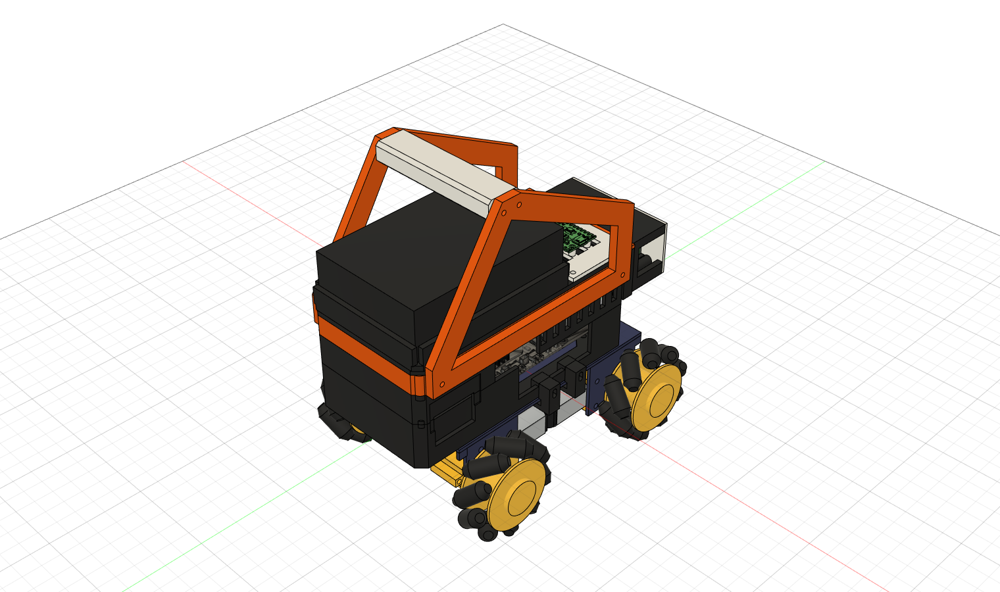

# Carcasa modular AGV — V6

## Revisión del 14 de noviembre de 2026

[Montaje actualizado y editable en Autodesk Fusion](AGV_V6_Soporte_Pico_2W.f3d)

- Soporte vertical amarillo de la Pico 2 W con rebajes para micro-USB de 8 mm de ancho en ambos extremos.
- Piso adicional para fijar los laterales del asa a los anclajes existentes.
- Cuatro alojamientos para insertos térmicos Ruthex M3 S en el piso nuevo y cuatro en la empuñadura superior. Cada alojamiento mide Ø4 mm × 5 mm.

Las cotas se comprobaron en Fusion. Quedan pendientes el encaje en la impresión y la prueba de carga de las asas. Los visores e informes de abajo corresponden al montaje histórico de octubre.

## Revisión histórica del 27 de octubre de 2026

## Ver el coche en 3D

**[Abrir el visor 3D de GitHub](AGV_V6_visor_solo_vista.stl)** — arrastrar para girar y usar la rueda del ratón para acercar o alejar. Es una malla ligera del montaje para consulta, no una pieza que se deba imprimir entera. El STL se muestra sin los colores del CAD.

**[Descargar el visor autónomo en color](https://github.com/jmopbcn-cmd/Agv-version-2.0/raw/refs/heads/main/cad/carcasa_v6/Visor_AGV_V6.html)** — guardar el archivo HTML y abrirlo con un navegador actual. Permite girar, acercar, ver los encoders por debajo y ocultar la carcasa, la electrónica o el grupo de motores, ruedas y sensores. No requiere instalación, servidor ni subir el modelo a otra web.

Los visores son versiones ligeras y omiten la malla detallada de la Pi 5 con refrigerador. La referencia completa permanece en el archivo editable de Fusion.

## Archivos de diseño

- [Montaje completo editable en Autodesk Fusion](AGV_V6_Montado_motores_ruedas.f3d).
- [Comprobación de carrocería y encoders](verificacion_carroceria_encoders.json).
- [Comprobación inicial del montaje de motores y ruedas](verificacion_montaje_motores_ruedas.json).

El archivo de Fusion se entrega ensamblado. Los componentes REF_ son referencias de hardware o auxiliares, no piezas destinadas a imprimir. Las copias REF_IMPRESION permanecen ocultas. No se incluye G-code listo para ejecutar.

## Diseño incluido

- Carrocería negra con naranja vivo: franja central, tramo superior, tapa, base de la Pico, marco frontal de cámara y asa. Se han eliminado los acabados blancos de las piezas de la carcasa.
- Cola elíptica que se prolonga hasta Y = −115 mm, fuera del contorno del chasis, con transición inferior inclinada. Esquinas principales de radio 4 mm y frontal de cámara con esquinas de radio 5 mm.
- Carcasa en tres tramos y fijación vertical en las esquinas. Base y tramos mantienen una región sólida conectada cada uno. La nueva forma requiere volver a preparar las placas de impresión.
- Alojamiento para Raspberry Pi 5 con refrigerador y Fusion HAT+, batería SunFounder y powerbank.
- Cámara frontal ESP32-CAM MB en cartucho extraíble con guías y pasador. Envolvente de referencia: 40 × 27 × 22 mm.
- Pico 2 W horizontal arriba, con acceso al USB y reserva para pines y cables de encoders y sensores.
- Pestañas de fijación al chasis y asa por encima de la batería, anclada a la carcasa.
- Cuatro motores TT, cuatro ruedas Mecanum con rodillos amarillos y centros y discos negros, y tres placas verticales añadidas a la placa existente del chasis.
- Cuatro discos encoder de 20 ranuras, diámetro 25,75 mm y espesor 2,4 mm, situados en las salidas interiores de los motores. Cuatro sensores LM393 colocados para que los discos pasen por sus horquillas. Su sujeción física sigue pendiente de validar.

## Comprobaciones y límites

El informe geométrico actualizado no detecta intersecciones positivas entre discos y sensores, sensores y chasis/anclajes, carrocería y ruedas, ni carrocería y laterales del asa. La comprobación inicial tampoco detectaba solapes entre las pestañas y las ruedas o las tres placas añadidas. Son comprobaciones del CAD; no sustituyen una prueba física ni verifican todo el montaje.

Las ruedas son una aproximación visual de 60 × 27 mm con nueve rodillos; no son el modelo exacto del fabricante. Las tres placas añadidas se han obtenido por simetría de la placa del CAD aportado. Los motores proceden de una envolvente CAD basada en un plano, con algunas cotas estimadas. Baterías, HAT y cámara requieren cotejo con las piezas físicas.

## Pendiente

1. Actualizar la distribución y el laminado de las piezas tras la prolongación de la carrocería. Probar primero los encajes pequeños.
2. Revisar especialmente las llaves del cartucho de cámara y sus alojamientos para las cabezas de tornillo antes de dar por definitivo el laminado.
3. Imprimir y comprobar guías, cartucho, pasador y uniones entre tramos.
4. Confirmar tornillería, fijación de LM393, medidas reales y acceso a conectores y cableado.
5. Validar la resistencia del asa y los anclajes antes de levantar el vehículo. No hay carga admisible calculada ni ensayada.
6. Terminar y comprobar las piezas pequeñas unidas por puentes recortables tipo maqueta; no se considera resuelto en esta entrega.

## Referencias de terceros

Consultar [atribuciones y alcance de licencias](REFERENCIAS.md).
