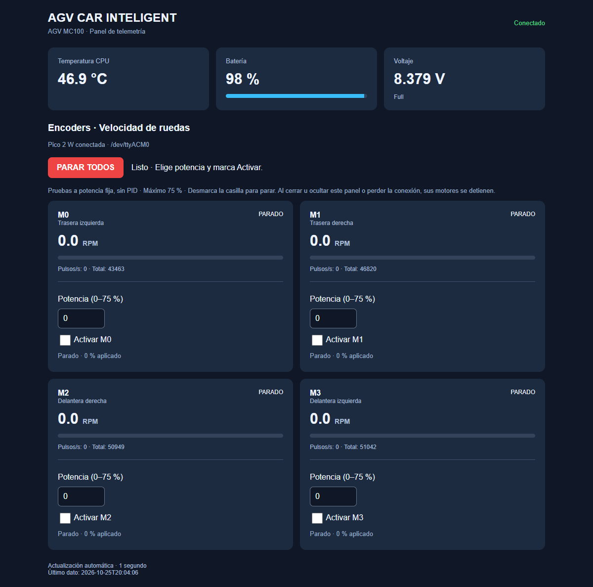

# Control manual desde el panel web

Cada tarjeta M0–M3 permite elegir una potencia de 0 a 75 % y marcar Activar. El control aplica potencia fija, sin PID; desmarcar detiene ese motor. Con un motor activo, cambiar el valor y salir del campo aplica la potencia nueva. El estado mostrado indica la potencia confirmada por el servidor. A 0 % el motor queda parado.

PARAR TODOS detiene todos los motores del control web, tambien desde otro panel conectado. No detiene programas externos independientes. Un solo panel puede controlar motores a la vez. Las pruebas PI y la herramienta de estabilidad comparten el bloqueo /tmp/agv-pid.lock, por lo que no pueden coincidir con control web activo.

Al cerrar u ocultar la pagina, esta solicita parada y cierra la conexion. Sin renovaciones del panel durante 2,5 s, el servidor solicita parada. El proceso de motores dispone ademas de un watchdog independiente de 3 s sin ordenes del servidor, incluido cierre inesperado del servidor. Tras volver al panel o reconectar, hay que activar los motores expresamente. No se guarda ni restaura una potencia activa al reiniciar.

El maximo 75 % se valida tanto en el servidor como en el proceso que aplica potencia: no depende del limite del campo HTML. No se detiene por RPM cero, para permitir alinear sensores a potencia fija; la perdida de telemetria visual no autoriza a interpretar una lectura antigua como actual. El panel detiene su control al dejar de recibir mensajes del servidor. Este panel es para la red local del equipo, no configura acceso remoto ni autenticacion adicional.

Preparar ejes libres, chasis estable y cables fuera del giro antes de activar. El boton web no sustituye el corte fisico de alimentacion. Los errores de hardware pueden impedir confirmar una parada; comprobar fisicamente antes de manipular el conjunto.

## Comprobaciones de esta implementacion

11 pruebas automatizadas con motores simulados: limites en ambas capas, independencia, propietario unico, desconexion, renovacion, watchdog del servidor, watchdog del proceso, cierre de entrada, bloqueo con otras pruebas, rechazo de orden invalida y parada general. Prueba de interfaz en navegador simulado: cuatro casillas independientes, 75 % permitido, 76 % rechazado, desactivacion con campo invalido, parada general, desconexion y vista movil. No se accionan motores reales para validar esta implementacion.

Pruebas sin hardware:

~~~bash
cd /home/olmos/Agv-version-2.0
python3 -B raspberry/tests/test_control_motores.py
python3 -B raspberry/tests/test_pid.py
~~~

La pagina real instalada se reviso desde navegador: cuatro controles disponibles, sin errores JavaScript y todos desactivados. El servidor real rechazo valores 76, negativos, booleanos y texto; acepto desactivacion a cero y parada general. Ninguna prueba de esta validacion envio potencia positiva al hardware.

